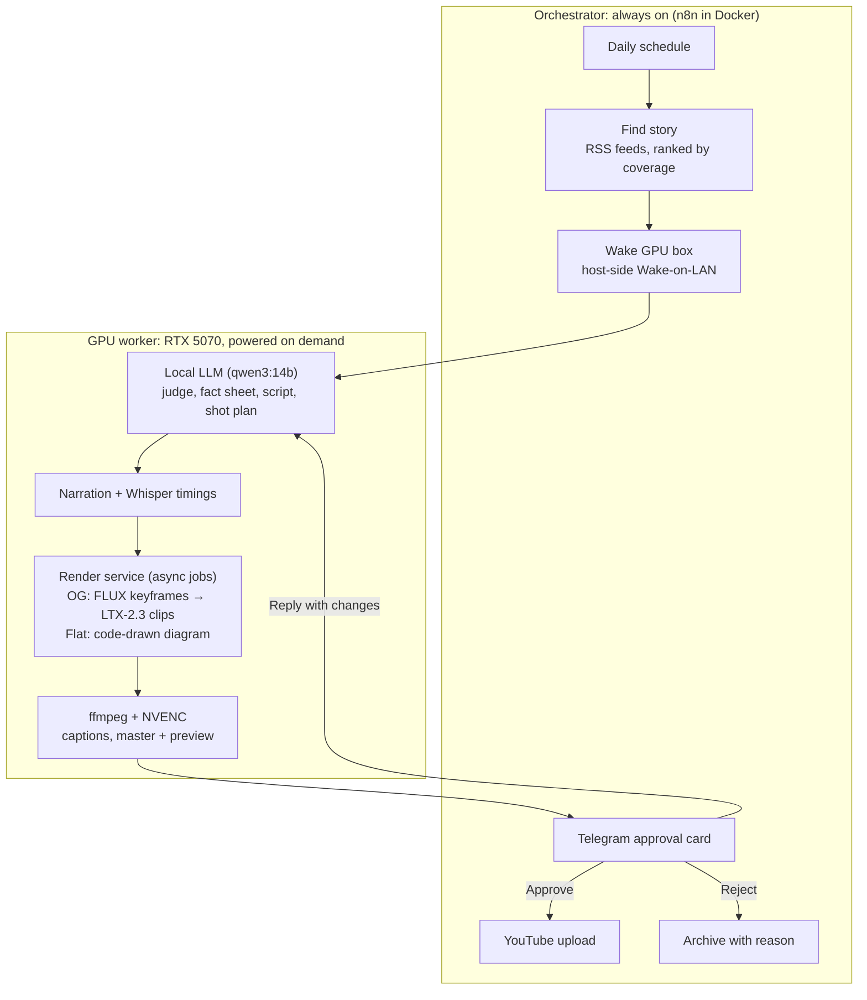

# JuiceBot-AI: a self-hosted AI news-video pipeline

Every morning, a pipeline on two machines in my house picks the day's top cybersecurity story. It writes a fact-checked script, narrates it and animates it, then sends the finished vertical video to my phone. I tap **Approve** and it's on YouTube Shorts. Nothing publishes without that tap.

The rule I built it around: **running it costs zero paid API tokens.** Story judging, fact extraction and script writing run on a local LLM. Narration is local TTS, captions come from local Whisper, and the images, video clips and final render all run on my own 12 GB GPU. Cloud AI helped me build it. It doesn't run it.

> The source code is private. This repo is a write-up of how it works and what broke along the way.

<!-- MEDIA: a finished video, OG style next to flat style -->

---

## What happens each day

1. **05:00:** a schedule trigger fires on the always-on orchestrator.
2. **Pick a story:** eight security-news RSS feeds are pulled and grouped by story. Stories get ranked by how many outlets carry them, and anything covered in the last week is skipped. A local LLM judges the top four the way I would, using my past approve/reject decisions as a taste reference.
3. **Wake the GPU box:** it's normally off, so a Wake-on-LAN packet brings it up. The pipeline waits until its services answer.
4. **Fact sheet:** the LLM pulls facts out of the source articles, and code checks each fact against the article text before anything is written.
5. **Script:** four acts (what happened, why it matters, how it happened, what to do), with spoken signposts and on-screen act badges. Code rejects any number that isn't on the fact sheet.
6. **Narration:** TTS on the GPU, then Whisper word timestamps that drive both the shot timing and the word-by-word captions.
7. **Visuals:** in one of two styles (below), plus company logos pulled from Wikidata/Commons and a date badge so it's obvious the news is current.
8. **Assembly:** ffmpeg + NVENC builds a full-quality master and a phone preview.
9. **Approval card in Telegram:** the video, title, description, sources and why this story was picked. **Approve** uploads it to YouTube. **Reject** archives it with a reason. **Replying with changes** gets a proposed edit and a re-render.

If any step fails, I get a Telegram alert, and one command remakes the day's video.

<!-- MEDIA: Telegram approval card with Approve / Reject -->

---

## Architecture

| Part | What it runs on |
| --- | --- |
| Orchestrator | 2018 Intel Mac mini, Ubuntu 24.04, 32 GB RAM, always on |
| GPU worker | Ryzen 7 7800X3D, RTX 5070 (12 GB), Windows 11, **off unless needed** |
| Workflow engine | n8n, self-hosted in Docker |
| LLM | Ollama, `qwen3:14b` |
| Images / video | ComfyUI: FLUX.1-schnell (keyframes), LTX-2.3 22B distilled (image-to-video), both GGUF |
| Voice | Chatterbox-Turbo on the GPU (started on Kokoro-82M on the CPU) |
| Captions | faster-whisper word timestamps |
| Diagrams | Skia + NumPy, drawn frame by frame in code |
| Remote access | Cloudflare Tunnel + Cloudflare Access, no open ports |
| Approval | Telegram bot, through a self-hosted Telegram Bot API server |

The orchestrator has to be always on, but the GPU box is a desktop I actually use, and leaving it running 24/7 for one morning job is wasteful and loud. So the most interesting problem was the line between the two machines: the orchestrator has to wake the worker, confirm it's ready, and fail cleanly when it isn't.

<!-- MEDIA: n8n workflow canvas -->

---

## Two visual styles

**OG:** every sentence becomes a shot. The LLM writes a keyframe prompt and a motion prompt for each one, FLUX.1-schnell draws the keyframe, and LTX-2.3 animates it (always image-to-video, which keeps shots consistent). Jobs are batched by model, so all keyframes render first and then all clips, because reloading 14 GB of weights per shot would cost more than generating the shot. Code-drawn maps, stat cards and logo tiles are cut in between. It takes about half an hour per video.

**Flat:** one evolving explainer diagram, drawn entirely in code: no image model at all. The LLM plans a board of parts (servers, browsers, code panes, people, clouds) and beats (data stolen along a link, a crowd fanning out, a connection cut, an alarm). A follow camera then glides around a board bigger than the screen, from one focus to the next. There are five looks (board, chalk, whiteboard, terminal, blueprint). It takes about 15 minutes per video.

<!-- MEDIA: a flat-style frame or short GIF -->

---

## Keeping it accurate

News is unforgiving, so most of the "intelligence" is code that checks the model rather than prompts that trust it:

- **Facts first, prose second.** The script can only use numbers that appear on the fact sheet, and the fact sheet is checked against the source articles.
- **Model for judgment, code for counting.** A 14B model won't reliably hit a word count or follow "at most two sentences may start with *He*." Over 19 generations it broke that cap every time. So everything countable is enforced in code. Length is fixed by expanding the finished script, not by asking harder.
- **Advice comes from the story.** The "what to do" act has to come from the articles, not generic security tips.
- **Speech gets its own copy of the text.** Whisper heard the narrator say "12:47" as "12,047" and mangle version numbers. Times, dates and versions are spelled out in the narration copy only, then checked by running Whisper on the audio.
- **Made-up lettering gets removed.** Image models invent fake text on signs and screens. OCR finds it, the keyframe is redrawn once, and anything left is inpainted away.
- **Uploads are labeled.** Every video is marked as altered/synthetic content on YouTube.

---

## Things that broke, and what fixed them

### Wake-on-LAN from inside Docker

Docker's NAT bridge doesn't forward broadcast traffic, so a magic packet sent from the n8n container never reaches the LAN. Instead, n8n SSHes to the host with a key restricted by `command=` in `authorized_keys`, so that key can run exactly one script: the wake script. If the credential store were ever compromised, the worst an attacker could do is turn on my desktop.

### The MAC address that wasn't

The first cold-wake test failed silently. The MAC I'd logged for the wired NIC belonged to a **Hyper-V `vEthernet` switch bridged to the Wi-Fi card**. On a Hyper-V host, `ipconfig /all` lists several adapters that all read like Ethernet. Match on the *Description* (the physical chipset), never on the label.

<!-- MEDIA: ipconfig, vEthernet vs the physical NIC (MACs blurred) -->

### "Packet not arriving" vs. "machine ignoring it"

The most useful single move: run Wireshark **on the target while it's still on**, filtered to `eth.dst == ff:ff:ff:ff:ff:ff && udp`. That splits network-side from host-side in one step. In my case the packet arrived fine and the machine was ignoring it.

<!-- MEDIA: Wireshark capture of the magic packet (payload blurred) -->

### Four layers, any one of which kills wake from full shutdown

| Layer | Setting |
| --- | --- |
| Windows | Fast Startup **off** (otherwise "shutdown" is really hibernate and the NIC loses wake state) |
| NIC driver, Power Management | all wake options on |
| NIC driver, Advanced | "Shutdown Wake-On-Lan" **on** |
| BIOS, APM | "Power On By PCI-E" **on** |

Missing any one of them gives the same symptom: the packet arrives and nothing happens.

<!-- MEDIA: BIOS APM screen -->

### Structured output shortened the scripts

Asking the LLM for the script *and* its metadata in one multi-field JSON schema made it write ~100-word scripts and ignore explicit length rules. That happened with both `qwen2.5:14b` and `qwen3:14b`, with or without thinking mode. A schema with only the script field didn't do it. The fix is two passes: plain prose first, then a schema call that only produces the title, tags and sources. Structured output is for structured fields, not for prose.

### Installing services on Windows you can't SSH into

The GPU box has no remote shell (the only key pointing at it is the wake key), so every install is a committed PowerShell script I run by hand. Each one logs a transcript, fails loudly, and can be re-run safely. Some things they had to defend against:

- **`uv` hardlinks packages out of its cache, and a hardlink shares the cache's ACL.** The service account couldn't import its own packages. Worse, two venvs built from one cache *share* those files, so fixing one venv's permissions silently broke the other's. The fix is copy-mode installs plus a check that sampled files have a link count of 1.
- **`secedit /configure` returns 0 whether or not it applied anything.** Granting "log on as a batch job" this way reported success and did nothing. I replaced it with `LsaAddAccountRights` via P/Invoke, verified by reading the rights back.
- **Exit code 0 can mean failure.** One server calls `exit(0)` when its model files are missing, so a scheduled task logs success while nothing listens. Readiness is proved by polling `/health`, never by the process being alive.
- **A dependency released three days earlier broke transcription** (PyAV 19 dropped an argument faster-whisper still passes). Since then, every install comes from a hash-locked lock file.

### n8n silently caps workflow timeouts at one hour

That holds unless `EXECUTIONS_TIMEOUT_MAX` is raised. I found it by reading the source before a long render poll hit the limit.

### A 50 MB wall in Telegram

The cloud Bot API caps bot uploads at 50 MB, so only the compressed preview ever reached my phone. A self-hosted Telegram Bot API server takes files up to 2 GB, so the full-quality master now arrives as a document.

### The same drawing code ran 5× slower on the faster PC

The flat style's frames drew about 5× slower on the Ryzen box than on a 2018 Mac mini. I ruled out the pipe into ffmpeg, process priority and power settings one at a time, each with measurements. The cause: the Windows build of skia-python is compiled with MSVC, and Skia falls back to **scalar** (no SIMD) pixel code when it isn't built with Clang or GCC. The fix was to stop leaning on Skia for full-frame work: draw straight into a NumPy array, composite the static background once, and do the edge fades in NumPy. **331 → 52 ms per frame** on the Windows box, with output within 3–4 levels per channel of the old frames.

### A WAV that claimed to be almost 25 hours long

The first TTS server streams its response and writes a placeholder data size of `0xFFFFFFFF`. Divide that by the byte rate and a 5.5-second clip reports **89,478 seconds**. Duration is now parsed from the real bytes.

---

## Security

- No open ports. The orchestrator is reached only through Cloudflare Tunnel + Access, then n8n's own login.
- ComfyUI has no authentication, so it listens on loopback only, under its own low-privilege account. The render service on the same machine is its only client.
- The wake key is forced-command restricted and can run exactly one script.
- Credentials live in n8n's encrypted store. Host values (IPs, MACs, chat IDs) live in an untracked config file and are filled in at deploy time, and the deploy script refuses to run if any placeholder is left.
- A human approves every upload. There's no auto-post path.

---

## Stack

n8n · Docker · Ollama (qwen3:14b) · ComfyUI · FLUX.1-schnell · LTX-2.3 · Chatterbox-Turbo · faster-whisper · Skia · NumPy · ffmpeg/NVENC · Telegram Bot API · YouTube Data API · Cloudflare Tunnel + Access · Python · PowerShell
