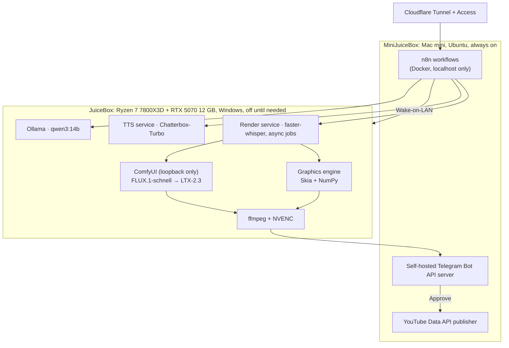
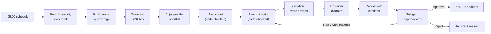

# JuiceBot-AI: A Self-Hosted AI Pipeline

**Every morning at 05:00, two machines in my house pick the day's top cybersecurity story, write and fact-check a script, narrate it, animate it, and render a finished YouTube Short. Then it texts me the video and waits. Nothing gets posted until I tap Approve.**

https://github.com/user-attachments/assets/5ca62d29-8a27-4b4d-8910-de45ebb7af49

**Watch the output:** [CyberJuice on YouTube](https://www.youtube.com/@CyberJuice.403)

> This repo is a write-up of the project. The source code is kept private.

---

## Overview

I wanted to see how far I could push an AI content pipeline with **zero paid AI at runtime**: no API tokens, no cloud GPUs, just open models on hardware I already own. It started out making history Shorts, and on 10/17 I switched it to cybersecurity news, which is closer to what I do every day in a SOC.

The catch: the GPU is in my everyday desktop, and I'm not leaving that running all day for one morning job. So the always-on orchestrator (my [MiniJuiceBox](https://github.com/yossefhabib/MiniJuiceBox) Mac mini) wakes the desktop with Wake-on-LAN, waits until every service proves it's ready, hands it the work, and lets it go back to sleep.

**Environment:**

- Orchestrator: 2018 Mac mini (MiniJuiceBox), i7-8700B, 32 GB, Ubuntu 24.04 (t2linux), always on
- GPU worker: Ryzen 7 7800X3D, RTX 5070 12 GB, Windows 11 Pro, off until needed
- Workflow engine: n8n 2.x, self-hosted in Docker, localhost only
- Models: Ollama (qwen3:14b), Chatterbox-Turbo (voice), faster-whisper (captions), ComfyUI with FLUX.1-schnell + LTX-2.3 (images and video)
- Approval: private Telegram bot through a self-hosted Bot API server
- Remote access: Cloudflare Tunnel + Cloudflare Access, zero ports forwarded

**Highlights:**

- **Runs itself.** The video is usually waiting on my phone before I'm up. A failed run sends an alert, and `/run` retries it.
- **A human approves every upload.** There is no code path that posts on its own.
- **Accuracy is enforced in code.** The model writes; code checks every number, name and rule against the source articles and sends it back to fix what's wrong.
- **Nothing exposed.** Every GPU service runs as its own least-privilege account, and the image generator never leaves loopback.

---

## Architecture

  

---

## How a video gets made

1. **Find the story.** Eight security news feeds (The Record, CyberScoop, Krebs on Security, SecurityWeek, The Hacker News, Help Net Security, Dark Reading, BleepingComputer) get grouped into stories and scored by how many outlets carry each one, with diminishing returns and a penalty for stale news. Anything covered in the last week is skipped.
2. **Judge the shortlist.** The local LLM rates the top four on real people involved, a clear cause, a concrete step for the viewer, and hook strength. It uses my past approve/reject decisions as a taste reference, and the approval card shows me why it picked the winner.
3. **Build a fact sheet.** The model pulls facts from the source articles, and code checks each one against the article text before the script can use it.
4. **Write the script.** Four acts every time: *what happened, why it matters, how it happened, what to do*. "What to do" has to come from the story itself, not generic security tips.
5. **Narrate.** A cloned narrator voice (a public-domain audiobook reader) runs on the GPU. Whisper transcribes it back into word-level timestamps, which drive both the shot timing and the word-by-word captions.
6. **Draw and render.** The story becomes an animated explainer diagram (below), assembled with ffmpeg on the GPU's hardware encoder.
7. **Deliver and wait.** A phone preview, the full-quality master and an approval card land in Telegram.

  

---

## The look

### Flat: one explainer diagram (~5 minutes per video)

This is what the channel runs now. No image model at all. The LLM plans a board of parts (servers, browsers, code windows, clouds, people) and the beats of the story: data stolen along a link, malware spreading, a deadline, an alarm, a connection cut. My own graphics engine draws it frame by frame, and a virtual camera glides between focus points on a board bigger than the screen. Five looks (board, chalk, whiteboard, terminal, blueprint) rotate by day.

> **Hiccup:** Diagram frames drew about 5× slower on the Ryzen than on the Mac mini. Turns out the Windows Skia build falls back to scalar pixel code. Moving the full-frame work into NumPy took it from **331 ms to 52 ms per frame**.

### Before that: OG pictures and motion (~40 minutes per video)

The second version painted every sentence as its own shot. The LLM wrote a picture prompt and a motion prompt for each one, **FLUX.1-schnell** drew the keyframe, and **LTX-2.3** animated it, with code-drawn maps, stat counters and real company logos cut in between. Jobs were batched by model (every keyframe first, then every clip), because reloading 14 GB of weights per shot cost more than generating the shot.

> **Hiccup:** Image models love inventing fake lettering. Every keyframe went through OCR. If made-up text showed up, the frame was redrawn once, and anything left over was painted out.

It worked, but flat renders in an eighth of the time. The pipeline can still make OG videos with `/style og`; flat is the default.

https://github.com/user-attachments/assets/02669bcd-0e17-45ca-bc58-df031ab0b3f6

### Where it all started: a history slideshow

The channel didn't start as cybersecurity. The first plan was history: true stories that sound made up. The first videos used a different voice model (Kokoro-82M, running on the CPU), and the visuals were public-domain paintings, engravings and archival photos pulled from the web, each one with a slow zoom-pan.

It technically worked, but it looked like a slideshow, and the pictures often didn't match the line being read. It was pretty bad. That's what pushed me to generate the visuals myself.

https://github.com/user-attachments/assets/5af47f3f-fe1a-4771-8e60-5d85e9e5e000

---

## Running it from my phone

Everything is driven from a private Telegram bot that only answers my chat.

| Command / action | What it does |
| --- | --- |
| **Approve** | Uploads to YouTube right away, labeled as altered/synthetic content |
| **Reject** | Asks why, archives the video, and offers **Make another video** |
| *Reply to a video* | "Line 3 should say the patch came out October 8", "cut the line about X", "shorter title". The bot proposes exact edits with a **Render it** button. Several replies stack into one render |
| `/run` | Makes today's video now (retries the same story after a failure, picks a new one after a rejection) |
| `/run <link>` | Makes a video about any article I paste in, at any time of day, not just the 05:00 pick |
| `/style flat` · `/style og` | Switches the default visual style |
| `/stats` · `/stats week` | Videos made, decisions, views and watch share. A weekly report also arrives every Sunday |
| `/queue` · `/script` | Upload status, and the script with timestamps |

  
  
  

Left to right: Reject asks why · rejecting a repeat story in plain words, then <code>/run</code> picks a new one · <code>/run &lt;link&gt;</code> makes a video from any article, any time

---

## Keeping a small model honest

News doesn't forgive mistakes, so most of the "intelligence" here is code that checks the model, not prompts that trust it.

- **Facts first, prose second.** The script can only use numbers and names on the fact sheet, and the fact sheet is verified against the source articles.
- **The model judges, the code counts.** A 14B model won't reliably hit a word count or follow "at most two sentences may start with *He*". It broke that rule in 19 of 19 test runs. Every countable rule is checked in code and fed back for a retry, and anything still wrong after the last try gets flagged on the approval card.
- **Speech gets its own text.** Whisper heard "12:47" read aloud as "12,047". Times, dates and version numbers are spelled out in the narrator's copy only, and the on-screen script keeps the originals.
- **Every upload is labeled** as altered/synthetic content, because the narrator is a cloned voice.

Here's what that looks like on a real card. The checks caught a dropped fact, sentences that ran long and repeated settings, and the card tells me exactly where before I decide:

    

> **Hiccup:** Scripts kept coming back around 100 words no matter what the prompt said. The cause was asking for the script and its metadata in one JSON schema, which squashes output length. Now prose comes from a plain call, and a second call fills only the title, hashtags and sources.

---

## Getting the GPU box to cooperate

Most of my time on this project went to one loop. JuiceBox has no remote shell on purpose: the only key that reaches it can turn it on and nothing else. So every change on it is a PowerShell script. Claude Code wrote it on MiniJuiceBox, I copied it over with WinSCP, ran it by hand in an elevated PowerShell, and when it failed, brought the log back so we could fix it and go again.

Every script is idempotent, stops at the first error and writes a transcript, so a failed run is always safe to repeat. That `Fails` folder is where those logs piled up.

  

These were the ones that fought me the most:

> **Hiccup #1:** The Wake-on-LAN packet from n8n never woke the PC. Docker's NAT bridge doesn't forward broadcast traffic. **Fix:** n8n SSHes to its own host with a key that can run exactly one script, and the host sends the packet.

> **Hiccup #2:** The packet arrived and the PC still slept. Wake was disabled at layers below Windows. **Fix:** Fast Startup off, NIC power management, NIC "Shutdown Wake-On-Lan", and BIOS "Power On By PCI-E". Miss any one of the four and you get the exact same silent failure.

  

> **Hiccup #3:** A service showed "running" but nothing was listening. The server had exited cleanly when its model files were missing. **Fix:** readiness is proven by polling each service's `/health`, never by the process being alive.

> **Hiccup #4:** Every service runs as its own non-admin account, and the shared `C:\Services` folder has inheritance broken so each account only gets what it needs. Locking it down that tight broke Ollama with a plain "Access is denied". Process Monitor, filtered to `ollama.exe` and `ACCESS DENIED`, showed the denial wasn't on its own models folder at all. It was on the parent `C:\Services` folder. **Fix:** grant that account read and list on the parent folder only, nothing below it.

  

---

## Security

**Getting in**
- **Nothing is exposed to the internet.** The workflow engine and bot server listen on localhost only and are reached through Cloudflare Tunnel + Access, then their own login. No ports are forwarded on the router.
- **The bot only listens to me.** Telegram's webhook has to carry a secret header, and any message that isn't from my chat is dropped.
- **No remote shell on the GPU box.** Every change there is a script I run by hand. The only key that reaches it is locked to a single command, so a stolen wake key can only turn my PC on.

**On the GPU box**
- **Least privilege.** Each service runs as its own non-admin account, with folder permissions granted one account at a time.
- **Firewall scoped to one machine.** The three services that listen on the LAN only accept connections from the orchestrator. The image generator has no authentication of its own, so it never leaves loopback, and the render service is its only client.
- **Exposure review.** When I started, Ollama listened on every interface with no authentication. I locked it down, closed Hyper-V management ports that were open to the LAN, removed stale firewall rules, and uninstalled ASUS DriverHub after its one-click remote code execution bug.
- **Smart App Control stays on.** When it blocked a component, I swapped in a widely used, pinned build instead of turning it off.
- **Pinned, hash-checked installs** for every package and model, from Python dependencies down to model weights.
- **Firewall backups.** After one bad command disabled all 622 firewall rules at once (restored from a shadow copy), the firewall state gets saved before every change, with a copy kept off the box.

**In the code and the output**
- **Secrets never touch git.** Credentials live in n8n's encrypted store, and IPs, MACs and the chat ID live in a gitignored config filled in at deploy time. I rewrote the repo's history to remove the ones that had slipped in.
- **A human approves every upload,** and every upload is labeled as altered/synthetic content.

---

## Key Takeaways

| Issue | Root Cause | Fix |
| --- | --- | --- |
| WoL packet from n8n never woke the PC | Docker's NAT bridge doesn't forward broadcast | SSH forced-command key; the host sends the packet |
| Packet arrived, PC still slept | Wake disabled below the OS | Fast Startup off, NIC power settings, NIC wake-on-shutdown, BIOS PCI-E wake |
| Code changes didn't reach the 05:00 run | n8n 2.x saves edits as drafts; schedules run the *published* version | Deploy script that validates, uploads and publishes every workflow |
| Scripts stuck at ~100 words | One multi-field JSON schema suppresses output length | Plain prose call, then a separate metadata call |
| Diagram frames 5× slower on Windows | Windows Skia build falls back to scalar pixel code | Full-frame work in NumPy: 331 → 52 ms/frame |
| A 5.5 s audio file measured 89,478 s | Streaming TTS writes a placeholder size in the WAV header | Compute duration from the bytes actually present |
| Service "running", nothing listening | Server exited cleanly with missing model files | Readiness = `/health` answers, not process alive |
| Ollama's service account got "Access is denied" | Broken inheritance on `C:\Services` left it unable to read the parent folder | Found with Procmon; read/list on the parent folder only |
| All 622 firewall rules disabled at once | A bare `Disable-NetFirewallRule` with no filter acts on every rule | Restored from a VSS shadow copy; firewall state now saved before every change |
| Transcription broke after a rebuild | A three-day-old dependency release dropped an argument | Hash-locked dependencies, down to the model weights |
| Only a compressed preview reached my phone | Telegram's cloud Bot API caps uploads at 50 MB | Self-hosted Bot API server (2 GB) |
| Long renders killed at 60 minutes | n8n's default execution time cap | Found the limit in n8n's source and raised it |

---

## Result

  

The pipeline runs on its own every morning and publishes to the CyberJuice channel after I approve. A video takes about 5 minutes to render on one consumer GPU, with no per-video AI costs.

**Watch the output:** [CyberJuice on YouTube](https://www.youtube.com/@CyberJuice.403)
---

## Built with

n8n · Ollama · Qwen3 · Chatterbox-Turbo · faster-whisper · ComfyUI · FLUX.1-schnell · LTX-2.3 · Skia · NumPy · ffmpeg · Telegram Bot API · YouTube Data API · Cloudflare Tunnel · Docker

Built by [Yossef](https://github.com/yossefhabib), with Claude as a pair programmer during development.

